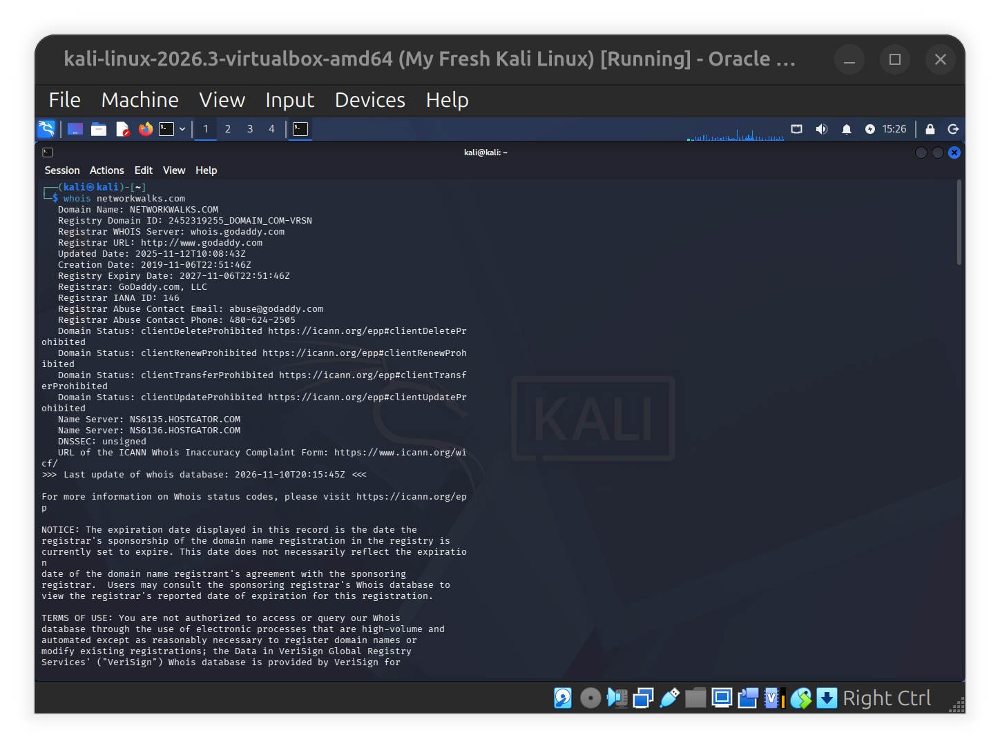
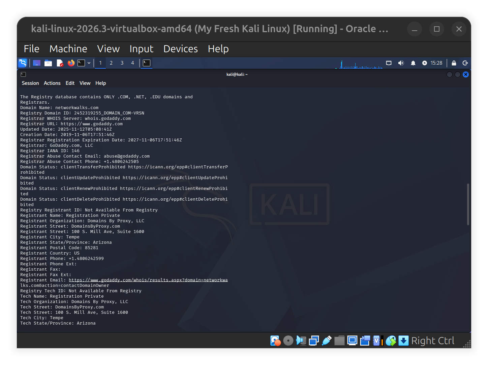

🛡️ FOOTPRINTING & SCANNING
W2-PM-FINAL | CYBERSECURITY | NETWORKING

  

 

Learning. Exploring. Securing.

 

<table width="100%"> <tr> <td bgcolor="#161B22" align="center" colspan="2">

<h2>👩‍💻 STUDENT PROFILE</h2> CYBERSECURITY PRACTICAL DOCUMENTATION

</td> </tr> <tr> <td width="50%" bgcolor="#0D1117">

PENTESTER NAME

Chengetai Bupe Mtengo

PROGRAM / BATCH

B082 – Networkwalks

</td> <td width="50%" bgcolor="#0D1117">

DATE

17 November 2026

MODULES COMPLETED

PM1 | PM2 | PM5

</td> </tr> <tr> <td bgcolor="#161B22" align="center" colspan="2">

FOCUS AREA

Footprinting • Reconnaissance • Network Scanning

</td> </tr> </table>

🎯 PROJECT OVERVIEW

This repository documents my practical learning journey through the Footprinting and Scanning phase of penetration testing.

Throughout these exercises, I explored different cybersecurity tools and techniques used to gather information about websites, domains, network infrastructure and publicly exposed digital assets.

The practical covered three modules:

Module	Focus Area
PM1	Footprinting & Reconnaissance
PM2	Google Hacking Database (GHDB)
PM5	Network Scanning with Zenmap

My objective was not simply to execute commands, but to understand how these tools work, why penetration testers use them and how attackers may use the information they reveal.

🔍 PM1 – FOOTPRINTING & RECONNAISSANCE

PM1 introduced me to the information-gathering stage of penetration testing. I explored different reconnaissance techniques and learned how information about websites, domains and their underlying infrastructure can be discovered.

🔎 TASK 1: WHOIS – DOMAIN INFORMATION GATHERING

Tool: WHOIS

Command executed:

bash
whois example.com

🎯 OBJECTIVE

Retrieve publicly available domain registration information using the Linux terminal.

🧪 FINDINGS / WHAT I LEARNED

WHOIS can reveal information such as:

Domain registration details.
Registrar information.
Domain creation and expiration dates.
Nameservers.
Registrant information, where publicly available.

⚠️ HOW ATTACKERS USE IT

Attackers may use WHOIS during reconnaissance to gather intelligence about domain ownership and associated infrastructure.

Ethical hackers use this information to understand an organisation's external digital footprint.

📸 TERMINAL EVIDENCE

🌐 TASK 2: WHATWEB – WEBSITE TECHNOLOGY FINGERPRINTING

Tool: WhatWeb

Command executed:

bash
whatweb example.com

🎯 OBJECTIVE

Identify the technologies running on a website, including:

Web servers.
Content Management Systems (CMS).
Plugins.
Web frameworks.
Other website technologies.

🧪 FINDINGS / WHAT I LEARNED

I learned that websites rely on different technologies to function.

WhatWeb helps identify these technologies through website fingerprinting, providing an overview of the software stack behind a website.

⚠️ HOW ATTACKERS USE IT

Attackers may use technology fingerprinting to identify outdated software and investigate publicly known vulnerabilities associated with particular technologies.

Penetration testers use this information to understand the technologies exposed by a web application and identify components that may need further security assessment.

📸 TERMINAL EVIDENCE

!WhatWeb Screenshot

🌍 TASK 3: NSLOOKUP – DNS RESOLUTION

Tool: Nslookup

Command executed:

bash
nslookup example.com

🎯 OBJECTIVE

Resolve a domain name into its corresponding IP address using the Domain Name System (DNS).

🧪 FINDINGS / WHAT I LEARNED

I learned that DNS translates human-readable domain names into IP addresses that computers use to communicate.

Nslookup helps retrieve DNS information associated with a domain.

⚠️ HOW ATTACKERS USE IT

Attackers may use DNS resolution during reconnaissance to discover IP addresses associated with target domains.

This information can help them map an organisation's internet-facing infrastructure.

📸 TERMINAL EVIDENCE

!Nslookup Screenshot

📡 TASK 4: CURL – HTTP RESPONSE HEADER ANALYSIS

Tool: cURL

Command executed:

bash
curl -I https://example.com

🎯 OBJECTIVE

Inspect HTTP response headers returned by a web server.

The exercise focused on identifying:

Server banners.
HTTP status codes.
Cookies.
Redirects.
Other HTTP response headers.

🧪 FINDINGS / WHAT I LEARNED

I learned that HTTP response headers provide useful information about how a web server communicates with clients.

They can reveal server information, response status codes, cookie-related information and website redirection behaviour.

⚠️ HOW ATTACKERS USE IT

Attackers may analyse HTTP response headers to identify server technologies, understand server behaviour and discover potentially insecure configurations.

Penetration testers use this information to assess web application security.

📸 TERMINAL EVIDENCE

!cURL Screenshot

🛡️ TASK 5: WAFW00F – WEB APPLICATION FIREWALL DETECTION

Tool: WAFW00F

Command executed:

bash
wafw00f https://example.com

🎯 OBJECTIVE

Investigate whether a website is protected by a Web Application Firewall (WAF).

A WAF helps protect web applications by monitoring and filtering HTTP traffic.

🧪 FINDINGS / WHAT I LEARNED

I learned about the role of Web Application Firewalls in protecting web applications against malicious requests.

WAFW00F helps identify whether a WAF is present and may identify the technology being used.

⚠️ HOW ATTACKERS USE IT

Attackers may attempt to identify the firewall protecting a website to understand its existing defensive controls.

Ethical hackers use WAF identification to assess an application's security architecture.

📸 TERMINAL EVIDENCE

!WAFW00F Screenshot

📋 TASK 6: DNS ENUMERATION – DNS RECORD DISCOVERY

🎯 OBJECTIVE

Explore DNS enumeration and identify the different DNS records associated with a domain.

The exercise focused on discovering:

DNS Record	Purpose
A	Maps a domain to an IPv4 address.
AAAA	Maps a domain to an IPv6 address.
NS	Identifies authoritative nameservers.
MX	Identifies mail exchange servers.
TXT	Stores text-based DNS information.
SPF	Defines authorised email-sending servers, usually through a TXT record.
SRV	Identifies servers providing particular services.
CNAME	Creates an alias pointing to another domain.

🧪 FINDINGS / WHAT I LEARNED

I learned that DNS records provide important information about how domains and their associated services are configured.

Different DNS records serve different purposes and help establish an understanding of an organisation's internet-facing infrastructure.

⚠️ HOW ATTACKERS USE IT

Attackers may use DNS enumeration to discover infrastructure, identify associated services and understand an organisation's external digital environment.

Security professionals use DNS enumeration to document and assess an organisation's digital footprint.

📸 TERMINAL EVIDENCE

!DNS Enumeration Screenshot

💡 WHY FOOTPRINTING MATTERS

Footprinting is an important stage of penetration testing because it provides the foundation for understanding a target environment.

It helps cybersecurity professionals:

Discover publicly available information.
Identify exposed infrastructure.
Understand website technologies.
Discover DNS records.
Identify potential security weaknesses.
Understand an organisation's external attack surface.

My takeaway: Before identifying vulnerabilities, we first need to understand the environment we are assessing.

🔎 PM2 – GOOGLE HACKING DATABASE (GHDB)

PM2 introduced me to the Google Hacking Database and demonstrated that Google is more than just a search engine.

I learned how advanced search techniques can be used to discover information that organisations may have unintentionally exposed online.

🌐 TASK 1: EXPLORING THE GOOGLE HACKING DATABASE

Tool: Google Hacking Database (GHDB)

🎯 OBJECTIVE

Explore how advanced Google search techniques can reveal publicly indexed information and potentially exposed systems.

🧪 FINDINGS / WHAT I LEARNED

One of our practical exercises involved searching for publicly exposed security camera interfaces.

During this exercise, I discovered some camera links that appeared to be accessible online.

However, some feeds contained identifiable individuals.

I decided not to share the links or images because doing so could compromise people's privacy.

This experience helped me understand how publicly exposed devices can create security and privacy risks.

⚠️ HOW ATTACKERS USE IT

Attackers may abuse advanced search techniques to discover:

Exposed login portals.
Publicly indexed sensitive documents.
Misconfigured directories.
Administrative interfaces.
Publicly accessible devices.

🧠 MY ETHICAL REFLECTION

This practical taught me that just because information is publicly accessible does not mean it is ethical to access, download or distribute it.

I chose not to share the camera links because respecting people's privacy is just as important as developing technical cybersecurity skills.

My takeaway: Technical ability must always be accompanied by ethical responsibility.

🖥️ PM5 – NETWORK SCANNING WITH ZENMAP

PM5 focused on network scanning using Zenmap, the graphical user interface for Nmap.

I particularly enjoyed using Zenmap because its graphical interface made it easier to interpret scan results and visualise network topology compared to working exclusively through the Linux terminal.

This module helped me understand how network discovery supports penetration testing and network administration.

🐧 TASK 1: INSTALLING ZENMAP ON LINUX

Tool: Zenmap / Linux Terminal

Command executed:

bash
sudo apt update

🎯 OBJECTIVE

Prepare my Linux environment before installing Zenmap.

🧪 FINDINGS / WHAT I LEARNED

My installation process was slightly different from the provided instructions because I was using Linux.

I first updated my package lists before proceeding with the installation using APT and the appropriate installation instructions for my environment.

I also learned that certain scanning operations require elevated privileges, so I launched Zenmap with root privileges when necessary.

This practical improved my understanding of:

Linux package management.
Updating packages.
Installing applications.
Administrative privileges.
Using graphical cybersecurity applications.

📸 TERMINAL EVIDENCE

!Zenmap Installation

🌐 TASK 2: DISCOVERING MY LOCAL IP ADDRESS

Tool: Linux Terminal

Command executed:

bash
ip addr

🎯 OBJECTIVE

Identify my local IP address, network interfaces and LAN subnet.

🧪 FINDINGS / WHAT I LEARNED

I used the ip addr command to identify my local IP address and network interfaces.

This helped me understand my local network addressing and LAN subnet before proceeding with network discovery.

📸 TERMINAL EVIDENCE

!Local IP Address

🖥️ TASK 3: DISCOVERING LIVE HOSTS

Tool: Zenmap

🎯 OBJECTIVE

Use Zenmap to identify live hosts or devices within the authorised network environment.

🧪 FINDINGS / WHAT I LEARNED

I examined the scanning results to understand which devices were actively responding on the network.

Host discovery provides an initial overview of the devices available within a network.

⚠️ INDUSTRY APPLICATION

Network administrators and penetration testers use host discovery to identify active devices and understand their network environments.

📸 ZENMAP EVIDENCE

!Live Hosts

📊 TASK 4: IDENTIFYING THE NUMBER OF LIVE HOSTS

Tool: Zenmap

🎯 OBJECTIVE

Determine the number of live hosts discovered during the network scanning exercise.

🧪 FINDINGS / WHAT I LEARNED

I analysed the scan results to establish the number of active hosts identified within the network.

This helped me understand how network scanning can provide an overview of connected devices.

📸 ZENMAP EVIDENCE

!Live Host Count

📍 TASK 5: IDENTIFYING IP ADDRESSES OF LIVE HOSTS

Tool: Zenmap

🎯 OBJECTIVE

Identify the IP addresses associated with the discovered live hosts.

🧪 FINDINGS / WHAT I LEARNED

I examined the Zenmap results to identify the IP addresses of the discovered devices.

IP addresses help distinguish individual devices within a network and are useful for documenting network assets.

📸 ZENMAP EVIDENCE

!Host IP Addresses

🔗 TASK 6: IDENTIFYING MAC ADDRESSES

Tool: Zenmap

🎯 OBJECTIVE

Examine MAC address information associated with discovered hosts where available.

🧪 FINDINGS / WHAT I LEARNED

I learned that a MAC address is a hardware identifier associated with a network interface.

MAC addresses help network administrators identify devices on local networks and investigate unfamiliar devices.

📸 ZENMAP EVIDENCE

!MAC Addresses

🗺️ TASK 7: DISPLAYING NETWORK TOPOLOGY

Tool: Zenmap

🎯 OBJECTIVE

Use Zenmap's graphical capabilities to display and examine the network topology output.

🧪 FINDINGS / WHAT I LEARNED

I explored the network topology visualisation feature and learned how it provides a visual representation of the discovered network structure.

Network topology helps security professionals:

Understand network organisation.
Identify connected devices.
Visualise network relationships.
Support network security assessments.

📸 TOPOLOGY EVIDENCE

!Zenmap Network Topology

📄 SUPPORTING DOCUMENTATION

View Zenmap Network Topology PDF

🧠 SKILLS AND TOOLS ACQUIRED
Category	Tools / Skills
Reconnaissance	WHOIS
Technology Fingerprinting	WhatWeb
DNS Resolution	Nslookup
HTTP Analysis	cURL
Firewall Detection	WAFW00F
DNS Enumeration	DNS Records
Search Engine Intelligence	Google Hacking Database
Network Discovery	Nmap
Network Visualisation	Zenmap
Operating System	Linux
Networking	IP Addresses, MAC Addresses & Subnets
Ethics	Responsible Information Handling
⚖️ ETHICAL CONSIDERATIONS

Throughout these practical exercises, I learned that cybersecurity tools can be used for both defensive and malicious purposes.

My approach to cybersecurity is guided by the following principles:

Only assess systems with proper authorisation.
Respect people's privacy.
Do not redistribute sensitive information.
Work within the approved assessment scope.
Handle discovered vulnerabilities responsibly.
Document findings professionally.

I believe that technical knowledge must always be accompanied by ethical responsibility.

🏁 FINAL CONCLUSION

This Footprinting and Scanning practical has been an important milestone in my cybersecurity learning journey.

Through PM1, I learned how to gather information about domains, websites, DNS infrastructure and security controls using different reconnaissance tools.

PM2 introduced me to the Google Hacking Database and demonstrated how publicly indexed information can expose misconfigured systems. It also taught me the importance of respecting privacy and handling discovered information responsibly.

PM5 strengthened my networking knowledge through Zenmap. I gained practical experience identifying my local IP address, discovering live hosts, examining IP and MAC addresses, and visualising network topology.

Why This Knowledge Matters in the Cybersecurity Industry

Footprinting and scanning are fundamental activities in penetration testing, vulnerability assessment, network administration and security operations.

Organisations need cybersecurity professionals who can understand their infrastructure, identify exposed assets, investigate potential weaknesses and recommend appropriate security improvements.

This practical helped me understand that penetration testing is not simply about running commands or finding vulnerabilities. It requires technical knowledge, analytical thinking, attention to detail, proper documentation and ethical decision-making.

My biggest takeaway: You cannot secure what you do not understand.

This is only the beginning of my cybersecurity journey, and I look forward to developing more practical skills in ethical hacking, networking and information security.

👩‍💻 ABOUT THE AUTHOR

Chengetai Bupe Mtengo

Cybersecurity Student | Aspiring Penetration Tester | Linux & Networking Enthusiast

Program: B082 – Networkwalks

I am developing my practical cybersecurity skills through hands-on exercises, technical research and continuous learning.

Thanks for visiting my repository!

Learning today, securing tomorrow. 🛡️

W2-PM-FINAL | B082 – NETWORKWALKS

📁 REPOSITORY STRUCTURE
text
Footprinting-and-Scanning/
│
├── README.md
│
├── screenshots/
│   ├── pm1-whois.png
│   ├── pm1-whatweb.png
│   ├── pm1-nslookup.png
│   ├── pm1-curl.png
│   ├── pm1-wafw00f.png
│   ├── pm1-dns-enumeration.png
│   │
│   ├── pm5-installation.png
│   ├── pm5-ip-address.png
│   ├── pm5-live-hosts.png
│   ├── pm5-host-count.png
│   ├── pm5-host-ips.png
│   ├── pm5-mac-addresses.png
│   └── pm5-network-topology.png
│
└── docs/
    └── zenmap-network-topology.pdf
